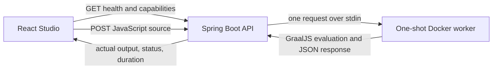

# PolyglotMesh mid-review demonstration

## Project overview

PolyglotMesh is a Java-hosted polyglot runtime sandbox. The current product demonstrates submitted JavaScript executed by a GraalJS worker. The Spring Boot WebFlux service accepts an execution request and, by default, starts a one-shot Docker worker. The React and Vite frontend uses the service health, runtime capability, and execution APIs.

## Problem statement

Embedding a guest language in a Java application is useful for controlled scripting, but it needs a clear boundary between host and guest and a way to report output and failures. This demonstration shows the existing JavaScript path and its current container controls. The API currently supports JavaScript only.

## Architecture



The UI's runtime capability response describes the runtime detected inside the API process. Docker worker availability is checked when an execution is attempted; the capability endpoint does not report Docker Engine status.

## Technologies used

- Java 25 and Spring Boot WebFlux
- GraalVM Polyglot API with GraalJS Community 24.1.2 in production
- Docker worker image based on Eclipse Temurin 25 JRE
- React, TypeScript, and Vite
- Maven and Vitest

## Current implementation

- `GET /api/health` reports backend health.
- `GET /api/runtime/capabilities` reports runtime and language detection from the API process.
- `POST /api/executions` accepts JavaScript and returns an execution ID, `SUCCESS` or `ERROR`, output, error, and measured execution time.
- Docker is the default execution provider. Each request uses a new container with networking disabled, a read-only root, dropped capabilities, no-new-privileges, memory/CPU/PID limits, a non-root user, and bounded temporary filesystems. Guest contexts also restrict host access and apply a statement limit.
- Studio examples are loaded into the editor without running. Session history contains actual requests and responses only and is cleared on refresh.
- Python is not available through the production execution API.

## Prerequisites

- Java 25 JDK and Maven 3.9 or newer
- Node.js and npm
- Docker Desktop or Docker Engine running
- The worker image `polyglotmesh-js-worker:day5`

## Start the backend

Build the backend and worker image from the repository root in PowerShell before starting the backend:

```powershell
.\scripts\setup-polyglotmesh-env.ps1
Set-Location .\backend
mvn package
Set-Location ..
docker build -f backend\Dockerfile.worker -t polyglotmesh-js-worker:day5 .
Set-Location .\backend
mvn spring-boot:run
```

The environment script prepares the current PowerShell session and validates the backend Maven project. Default API address is `http://localhost:8080`.

## Start the frontend

In another PowerShell session:

```powershell
Set-Location C:\Users\veera\Documents\PolyglotMesh\frontend
npm ci
npm run dev
```

Open the Vite URL, usually `http://localhost:5173`. To use another backend, set `VITE_API_BASE_URL` before starting Vite, for example `$env:VITE_API_BASE_URL = 'http://localhost:8080'`.

## Live demonstration

1. Open the frontend and point out the backend connection indicator.
2. Show the runtime name/version, host Java version, and per-language capability cards. These are live values from the backend API.
3. In Studio Canvas, choose **Simple calculation**. Selection loads code only; it does not execute.
4. Explain that Java hosts the Polyglot API and JavaScript is evaluated as the guest language.
5. Click **Run Code**. The frontend sends the edited source to `POST /api/executions`.
6. When Docker is running and the worker image is present, the API starts a one-shot isolated worker. Show the returned status, output, and API-measured duration.
7. Choose **Execution error** and run it to show a guest error response. The API result has status `ERROR` and includes the worker's error details.
8. Point to the Docker isolation controls described above. The API may return a worker unavailable response if Docker or the image is unavailable; the UI labels that failure and does not present it as successful execution.
9. Explain that GraalPy was exercised experimentally in a separate GraalVM 25.1.3 prototype. It is not integrated into production dependencies, the worker image, or the execution API.

Other selectable examples demonstrate console output, array processing, and JSON transformation. Editing an example and rerunning it is supported.

## GraalVM 25.1 prototype and Python status

`backend/prototypes/graalvm-25.1/` tests JavaScript and controlled GraalPy evaluation with aligned 25.1.3 components. Its ADR records passing prototype tests on Oracle JDK 25.0.1 using a fallback runtime, and the limitations of that environment. This isolated experiment is feasibility evidence only: it does not establish production availability, optimizing runtime behavior, or an OS sandbox for Python.

Production currently uses the GraalJS 24.1.2 dependency line and a Docker-isolated JavaScript worker. Do not claim Python is available from the production API.

## Current limitations

- Only JavaScript is accepted by the production execution API.
- Docker is required for the default isolated provider, and the worker image must be built locally.
- Runtime capabilities report the API process runtime, not Docker readiness.
- Execution history exists only for the current page session and is not persisted.
- The runtime compatibility findings and Python prototype results are specific to the separately documented environment.

## Future development roadmap

- Revalidate the runtime compatibility prototype on matching supported JDK/GraalVM distributions and current component releases.
- Evaluate isolate-based runtime compilation on supported platforms.
- With a separately tagged worker, assess Python image size, startup and memory cost, request protocol, errors, timeout behavior, and OS isolation controls before proposing any production API change.
- Add an explicit Docker readiness capability only if a reliable backend contract and operational need are established.

These are proposed next steps, not implemented production features.
